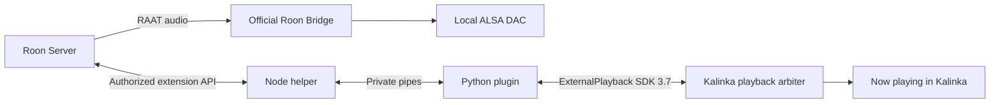

# Integration decisions

## Two independent Roon components

The official [Linux Bridge distribution](https://help.roonlabs.com/portal/en/kb/articles/linux-install)
owns discovery, RAAT and ALSA. A small Node child uses the official
[Roon extension API](https://github.com/RoonLabs/node-roon-api) to pair to one
Server, subscribe to zones, retrieve artwork and control a selected output.
The Python plugin manages both, translates state and participates in Kalinka
playback arbitration. Audio and its protocol remain in the unmodified Bridge;
a bounded read of its local log diagnoses the ALSA handover collision.



The official installers identify these downloads (checked during development):

| Linux userspace | Official archive |
| --- | --- |
| x86-64 | `https://download.roonlabs.net/builds/RoonBridge_linuxx64.tar.bz2` |
| ARM64 | `https://download.roonlabs.net/builds/RoonBridge_linuxarmv8.tar.bz2` |
| ARMv7 hard-float | `https://download.roonlabs.net/builds/RoonBridge_linuxarmv7hf.tar.bz2` |

A 32-bit Python on an ARM64 kernel selects ARMv7, subject to Roon's dependency
checker. Unsupported machines fail explicitly. HTTPS authenticates the
download origin; Roon does not supply an independently pinned signature in
this installation flow. This plugin does not claim otherwise.

## Ownership contract

`ExternalPlayback` is a separate SDK interface because `DirectPlayback`
claims a Kalinka renderer and expects a playable source. An external session
publishes existing `PlaybackState` and `PlaybackControl` events, so existing
Kalinka clients already display the badge, metadata and progress. The host
stamps progress using its own monotonic clock; Roon positions are converted
from seconds to milliseconds.

Companion implementation: [KalinkaPlayer PR #250](https://github.com/Kalinka-Player/KalinkaPlayer/pull/250),
initial commit `1212845eaaf6fefa3e8b30464db3a53a0009e86a`, released in
Kalinka 5.6.0.

Roon's [documented `stop` control](https://github.com/RoonLabs/node-roon-api-transport/blob/master/lib.js)
releases the audio device, but the Core acknowledges the command before the
Bridge finishes ALSA teardown. The revoke callback allows two seconds total for
the reply and DAC release, with the ALSA wait capped at 0.8 seconds. It then
terminates Bridge if needed (0.5 second grace), within the host's
three-second callback budget. Concurrent stops share the same cleanup task;
cancelling a waiter does not cancel hardware cleanup.

If Roon Server already runs locally as the same Unix user, the supervisor
attaches to its RAAT process instead of installing or launching Bridge. It
verifies the executable and RoonAppliance parent, derives the state directory
from the open RAAT log, and checks process start time to reject PID reuse.
Automatic output detection, measurements and collision logs use that Server's
RAAT state. Teardown controls only the selected zone; it never signals the
Server's process group. If Stop fails in this mode, the failure is reported;
the managed-Bridge kill fallback is unavailable. The supervisor reconnects
after the observed audio process exits.

In the opposite direction, the loading/playing notification acquires the
external hold, stopping the current Kalinka source. If Roon loses the opening
race, the local RAAT log records `snd_pcm_open: Device or resource busy` and
Roon returns to paused. The plugin requires fresh evidence for the exact local
output within three seconds of acquisition before retrying Play once. It waits
up to six seconds for ALSA to close first, allowing shared desktop audio to
suspend its device. It retains the hold and abandons recovery if revoked.
Recovery accepts a fresh zone snapshot and ignores older queued subscription
revisions, preventing its own paused events from undoing the successful retry.
Once the Bridge is observed running ALSA, further pauses are ordinary pauses.
Ordinary pause retains the exclusive session and reports PAUSED; Kalinka Play
continues to address Roon. Kalinka Stop, source takeover, output removal,
disconnect, or a Roon stopped state ends the session. An idle paused snapshot
does not acquire a new hold after startup or revocation.
No source-control or device-volume service is advertised. Roon may briefly
show a device-open error while this recovery completes.

The extension and Bridge share the Kalinka service cgroup. Normal plugin
shutdown also terminates their process groups, including children that ignore
SIGTERM. Pairing is persisted atomically with private permissions. An advisory
lock prevents two plugin instances sharing one state directory. All network
discovery/retries, installation and process startup run outside plugin setup's
latency budget. Startup also reaps orphaned process groups only when their user,
executable location, data root and launcher identify this private installation.
The launcher uses an instance name derived from its private data path and a
separate localhost RAAT rendezvous port (`-app` and `-refcountport`). Without
these, the Linux runtime attaches to an existing RAAT server on localhost:9004,
including one owned by Roon Server under the same Unix user. State-directory
aliases preserve existing device UUIDs and the diagnostic paths. These flags
are runtime implementation details, verified against Bridge 2.71; they are not
part of the public extension API. Roon may require the retained output to be
enabled again under the new instance name in Settings → Audio.
Roon transport state remains authoritative even if local hardware ownership is
unavailable or does not match; only output measurements depend on that check.
Loss of the extension is treated as loss of control over audio:
Bridge is stopped, ownership is released and the supervisor retries.

## Local output identity

Automatic selection reads the detected local Server's RAAT settings, or the
managed Bridge's `data/RAATServer/Settings/device_*.json`. For current ALSA builds, Roon's
output ID is `1701` followed by `UUID(unique_id).bytes_le.hex()`. This convention
was verified against both LAN endpoints during hardware debugging. It is not a
documented transport API guarantee: the result must match an advertised output
exactly. Names are never used to guess locality. Multiple local candidates are
supported without configuration: prefer a loading/playing local output, retain
the current selection among equally eligible outputs, otherwise take the first
by stable output ID. A changed encoding fails visibly and retains a manual
override. Outputs on other machines are excluded from automatic selection.

Each enabled Bridge audio device appears as a Roon zone. Users choose it with
Roon's [zone picker or Transfer Zone](https://help.roonlabs.com/portal/en/kb/articles/zone).
Selecting a zone in the Roon UI alone changes which zone that remote controls;
starting/transferring playback is what Kalinka follows. There is no single
Bridge-wide output selection. When several local outputs play concurrently,
Kalinka retains the current active output; its UI represents one session.

The same settings identify `hw:CARD=<id>,DEV=<n>`. Matching `/proc/asound/card*/id`
resolves the current card number, so renumbering does not bind the plugin to a
wrong DAC. Output measurements are shown only when ALSA's owner belongs to the
managed Bridge process group. Source codec, source rate/depth and the full Roon
signal path remain unavailable through the public transport API.

## Topology limits

The intended policy is **one active source per Kalinka server**. Roon takes
over from that server's queue or another plugin regardless of where the
renderer runs. Starting a different source on the same server stops Roon.
Playback to a remote renderer is intentionally stopped during this handover;
simultaneous sources controlled by one server are outside this integration.

That server-level policy is separate from physical DAC ownership. The SDK
arbiter does not provide an audio lease across processes on Bridge's host.

| Playback topology | Current behavior when Roon acquires the server hold |
| --- | --- |
| This server owns the local renderer's session | The server sends a session close. Roon may already be opening the DAC, and PipeWire may still hold the underlying hardware. |
| This server plays through a remote renderer | The remote session is intentionally closed to preserve one active source per server. |
| Another server owns the local renderer's session | That session is not closed. The renderer deliberately accepts close requests only from the session's owner. |
| No local Kalinka renderer | Bridge can play locally; this server's remote queue follows the same single-source policy. |

Supporting a local renderer owned by a different server needs an audio lease
on the renderer host, independent of the server currently sending its stream.
It must stop the local
renderer and notify its owning server when Roon takes over, and await Roon's
stop when any server starts that local renderer. This would complement the
single-source policy, not allow simultaneous sources on the same server.
Merely identifying a local renderer or sending a foreign SessionClose cannot
provide those guarantees. The current plugin does not implement that lease.

## Removing the experimental source control

The experimental convenience-switch handshake and its configuration have been
removed. Device release is now verified locally without that handshake. The companion server also returns to its earlier
session-close behavior. When updating both components, remove **Kalinka Roon
Bridge** from the output's **External Source Controls** in Roon's Device Setup
and restart Kalinka. Keep authorization under **Settings → Extensions** so
metadata and transport controls continue to work. On servers advertising
`external_playback.supports_volume`, the plugin acquires with `volume_control`
and reports the selected output's volume through `report_volume`. Slider
requests call Roon's existing transport `change_volume` API. This does not
advertise a new Roon device-volume service or require reauthorization.

The plugin does not change PipeWire configuration or other applications' audio
devices. Automatic recovery is limited to its own Bridge and the source owned
by the same Kalinka server.

## Diagnostics and browsing

`python scripts/roon_rpc.py --host raspberrypi.local` reads the paired Core,
selected output and live zones over SSH and the private
`/var/lib/kalinka/roon/pairing/control.sock`. The socket is inside the 0700 pairing
directory; credentials never leave the device. Commands such as
`control '{"control":"play"}'` act through the same extension as real Roon
transport controls, without pre-stopping Kalinka.

Roon provides an official [browse API](https://github.com/RoonLabs/node-roon-api-browse),
using its authorized extension WebSocket rather than a public REST library
endpoint. Browsing is deliberately opt-in: set `ROON_ENABLE_BROWSE=1` in the
Kalinka service environment and reauthorize the changed extension in Roon.
Then `scripts/roon_rpc.py browse '{"options":{"pop_all":true}}'` and
`browse_load '{"options":{"offset":0,"count":20}}'` inspect the hierarchy.
The default transport/image grant cannot use that extra service; a status of
`browse_available: false` describes the extension's grant, not absence of an API
in Roon Server. This diagnostic does not add a Roon library UI to Kalinka.

## Hardware acceptance procedure

1. On x86-64, ARM64 and ARMv7hf targets enable the plugin, check download and
   startup status, and verify Bridge advertises the expected ALSA device.
2. Authorize the extension, enable the desired local audio devices, and leave the
   output override empty in Kalinka. Verify pairing and the selected output survive a
   service restart. No external source or volume control is required.
3. Start Roon playback. Verify title/artist/album/artwork, duration, seek
   progress, the Roon endpoint badge, radio without a duration, and permitted
   next/previous/seek controls. Rename the zone and repeat.
4. Start a local file while Roon is playing, then Play in Roon while the
   local file is still playing. Repeat without intermediate Stop commands.
   Verify actual ALSA ownership, sustained progress, metadata, artwork and the
   browser stream-info dialog at every stage. Preserve Kalinka queue contents.
5. Pause and Stop from Roon and from Kalinka. Resume in Roon. Include grouping
   and ungrouping; confirm stop intentionally affects the selected zone's group.
6. Disconnect Roon Server during playback and kill the Node helper. Verify
   silence, released Kalinka ownership, process cleanup, retry status and
   pairing recovery. Delayed playing events must not steal a later source.
7. Disable the plugin during playback and verify no managed Roon process remains.
8. Compare automatically detected output rate/channels to ALSA and Roon's own
   signal path. Source format stays unknown, and the previous source's codec
   must not remain in the UI.

Automated tests and package builds do not replace these hardware checks.

Run the hardware/browser test explicitly (it plays audio and leaves playback
stopped). Choose a playable existing local track ID from `/browse/kalinka:localfiles:catalog:tracks`:

```sh
.venv/bin/pip install playwright
.venv/bin/playwright install chromium
.venv/bin/python scripts/e2e.py --host raspberrypi.local \
  --url http://raspberrypi.local:8000 --cycles 10 \
  --local-track kalinka:localfiles:track:YOUR_TRACK \
  --artifacts artifacts/e2e
```

The output override must be empty. The existing Roon queue must be playable (the
test can recover its previous queue from history after a Bridge restart). The
test appends one local track and removes it afterwards; it does not clear the
saved queue. Artifacts contain timestamped API/WebSocket state, physical ALSA
owner and parameters, screenshots, and accessible UI text. Journals identify
handover, collision, retry and teardown times. Tests are intentionally separate
from unit tests because they require real hardware and authorization.

## Verified on raspberrypi.local, 2026-10-10

The installed development build passed **20 consecutive Roon → local file →
Roon cycles**, in two ten-cycle runs. The second run followed a Kalinka service
restart. Both output and ALSA overrides were empty throughout. This is hardware
and browser validation of this topology, not a listening test or a guarantee
for every Roon output/platform.

| Component | Tested installation |
| --- | --- |
| Roon Server | Linux x86-64, 2.73 build 1700 |
| Endpoint | `raspberrypi.local`, native ALSA, HiFiBerry Digi |
| Kalinka server / renderer | 5.8.0 / 0.8.0 |
| Roon plugin | `0.1.2.dev0+g9893c7d.d20261010` |
| MusicCast plugin | `5.8.1~dev20+gd229e887.d20261010`, with startup fix below |
| Web UI | 0.18.0+28, with stream-state fixes below |

The test verifies advancing playback, the real ALSA owner executable and
RUNNING state, Roon title/artist/album against the transport snapshot, fetched
JPEG artwork, and Chromium's now-playing and stream-info UI. Roon output was
44.1 kHz stereo; the local FLAC output was 192 kHz stereo. Roon no longer retains
the local source's FLAC/24-bit details or queue index. Its unavailable source
format remains unknown. The restart run also passed seek to 30 seconds,
the previous pause/release policy and resume. That policy is superseded by the
pause-preserves-exclusivity regression coverage below.

The restart journal records ten detected ALSA collisions and ten successful
automatic recoveries. Roon-to-local release took 0.121–0.490 seconds in those
ten cycles. Returning to Roon can involve a short gap and a transient Roon
device-open error before the single retry succeeds. The trace captures this
recovery instead of pre-stopping local playback to avoid the race.

Evidence is retained locally under ignored artifact directories:

- `artifacts/final-ten-cycles/trace.jsonl`: first ten-cycle pass.
- `artifacts/restart-ten-cycles/trace.jsonl`: restart pass, control checks and
  exact saved-queue ID/order comparison (100 tracks preserved).
- `artifacts/restart-ten-cycles/kalinka-journal.txt` and `raat-tail.txt`:
  timestamped arbitration and RAAT diagnostics.
- Both directories contain main-screen and stream-info screenshots plus
  accessible UI text for every source transition.

Companion changes were necessary and are installed on the Pi:

- [KalinkaAI PR #108](https://github.com/Kalinka-Player/KalinkaAI/pull/108):
  replace nullable stream details on source changes, show external stream info
  even with an empty saved queue, and hide the saved-queue index during Roon.
- [KalinkaPlayer PR #314](https://github.com/Kalinka-Player/KalinkaPlayer/pull/314):
  MusicCast's initial standby discovery must not
  emit a new power-off transition that stops first playback. A power-on request
  arriving before discovery is applied when the device becomes ready.

Final review validation passed 63 plugin Python tests, 8 Node tests, all 1,087
Flutter tests and 45 MusicCast tests. Plugin lint/format checks, Flutter analysis
and the host repository's lint checks passed. Package/web builds also passed
during hardware deployment. Raw hardware artifacts remain local and are not
included in the repository.

Final device state: both Kalinka services active, playback stopped, ALSA closed,
automatic output selected, and the 100-track saved queue intact. The unrelated
SMSL zone remained paused at its original 293-second position. The Pi's original
plugin files, config and web bundle are backed up under
`/var/lib/kalinka/roon/debug-backup/`.

The existing transport/image authorization was retained. The optional browse
service is implemented but was not exercised with an expanded authorization;
`browse_available` therefore remains false. No additional authorization is
needed for the tested switching and status features. Grouped outputs, other
platforms, a renderer owned by another Kalinka server, and browsing with the
extra grant were not part of these two hardware runs.

Automatic-selection regression tests cover a stable first default, following playback
to another local output, retaining the idle choice, simultaneous local playback
without oscillation, output removal, remote-output exclusion, explicit overrides
and startup resynchronization. Multiple local outputs are simulated in these
tests; the Pi currently advertises one enabled local output.
All 63 Python tests passed. The updated package was installed on the Pi and
passed three more hardware/browser Roon → local → Roon cycles after restart,
including seek, pause, resume and preservation of all 100 queue entries.
Evidence is under `artifacts/multiple-output-default/`.
The final review run passed one additional cycle plus seek/pause/resume, with
the harness recording success only after queue preservation and cleanup.
Its evidence is under `artifacts/pr-review-final/`, bringing the recorded
successful cycles across these runs to 24.

## Local pause and playback-state regression

On 2026-10-11, the local host reproduced audible Roon playback with advancing
position while Kalinka continuously reported BUFFERING. The ALSA owner was an
orphaned RAAT process from the same private Bridge installation, outside the
current launcher's process group. Restart testing also exposed the local Roon
Server taking over the default RAAT rendezvous and replacing the Bridge's
devices with its own. Startup cleanup and attachment to the existing local
Server address those lifecycle faults. A managed Bridge uses instance
isolation when no local Server is available. Transport state no longer depends
on process-group matching.

The previous pause handler explicitly sent Stop and released the playback hold.
Pause now preserves the hold, track metadata and transport controls. Stopping
an already-paused session obtains a fresh subscription revision to rearm
playback even when Roon emits no further paused event, while excluding stale
events from before Stop.

The plugin regression suite passes 86 Python tests and ten Node tests. The
companion server volume change passes 126 focused server regressions and 36 SDK
tests, including amplifier delegation, stale events and pending-command teardown.

Live acceptance passed on 2026-10-11 against the local Roon Server and the
PipeWire Kalinka renderer: five complete Roon → local → Roon cycles, pause from
both apps without losing exclusivity, resume through Kalinka, and Stop → Play
from paused. The automatically selected output was the laptop's PCM31; no
output override was configured. Measurements matched its 48 kHz stereo ALSA
output. Metadata, artwork, progress and stream details were verified in the web
UI, rebuilt from its existing stale-metadata fix (`85f8390`). The saved two-track
queue was preserved. Artifacts are in `artifacts/local-volume-final/`.

With `--check-volume`, the browser's real slider lowered Roon's volume, Roon API
changes propagated back through the device WebSocket to the slider, and each
check restored the original level. These checks passed while playing and
paused. This optional live test requires an unmuted numeric 0–100 Roon output
with room to lower the level; unit tests also cover dB ranges and volume limits.
Roon's log on this laptop selects ALSA Master. Speaker is a separate gain stage,
so Roon's 100% does not bypass Speaker attenuation.

Earlier attempts on PCM0 failed while Firefox/PipeWire kept that device open.
The successful PCM31 run exercises source arbitration across two PCMs feeding
the same card; it does not establish exclusive-device collision recovery for
PCM0 while another application deliberately holds it.
```bash
.venv/bin/python scripts/e2e.py --host local --url http://127.0.0.1:8000 \
  --socket /home/envel/kalinka/var/lib/kalinka/roon/pairing/control.sock \
  --server-log /home/envel/kalinka/var/log/kalinka/server.log \
  --raat-log /home/envel/.RAATServer/Logs/RAATServer_log.txt \
  --local-backend pipewire --cycles 5 --check-volume \
  --local-track kalinka:localfiles:track:track_0fc9957e987c139a \
  --artifacts artifacts/local-volume-final
```
